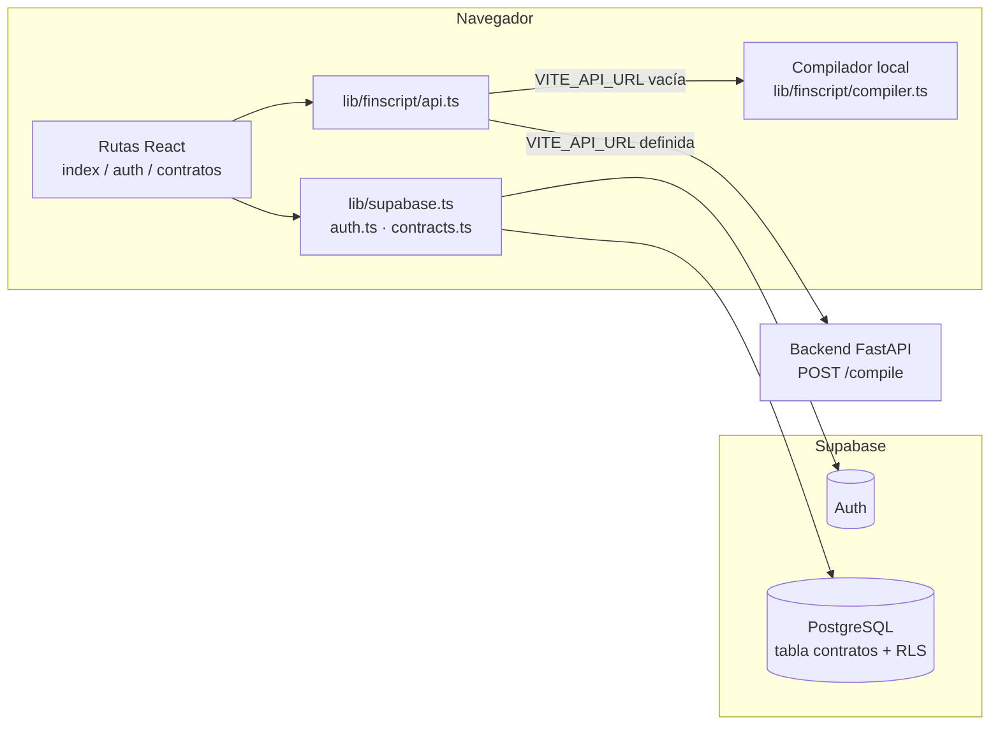
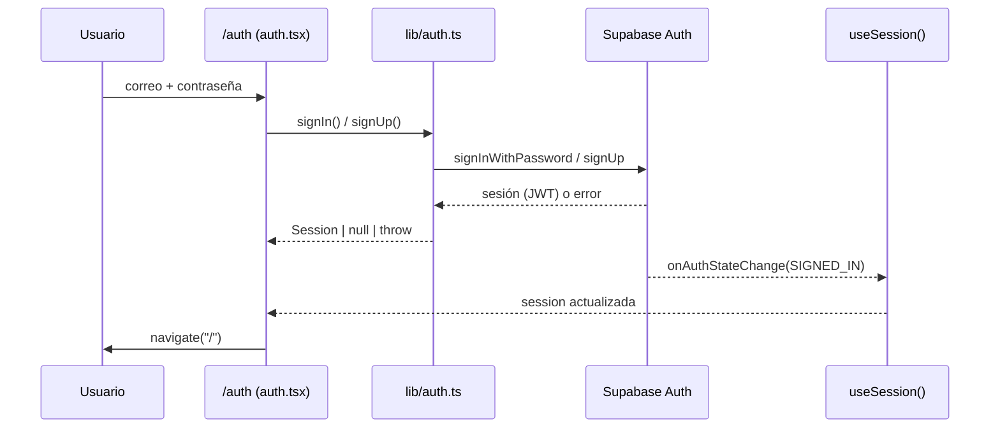
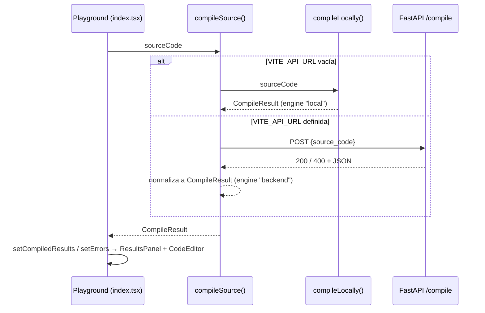

# Manual para desarrolladores — FinScript Compiler Web

Guía técnica para entender, ejecutar, modificar y extender el proyecto. Asume que sabes programar, pero no que conozcas este stack. Para el uso de la aplicación desde el punto de vista del usuario final, consulta [`manual-de-usuario.md`](./manual-de-usuario.md). Los requisitos originales están en [`prd.md`](./prd.md).

---

## Índice

1. [Visión general](#1-visión-general)
2. [Stack tecnológico](#2-stack-tecnológico)
3. [Estructura del repositorio](#3-estructura-del-repositorio)
4. [Puesta en marcha (entorno local)](#4-puesta-en-marcha-entorno-local)
5. [Variables de entorno](#5-variables-de-entorno)
6. [Scripts y herramientas](#6-scripts-y-herramientas)
7. [Arquitectura](#7-arquitectura)
8. [Frontend en detalle](#8-frontend-en-detalle)
9. [El compilador FinScript](#9-el-compilador-finscript)
10. [Backend (FastAPI)](#10-backend-fastapi)
11. [Base de datos (Supabase)](#11-base-de-datos-supabase)
12. [Sistema de estilos](#12-sistema-de-estilos)
13. [Convenciones de código](#13-convenciones-de-código)
14. [Flujo de trabajo con Git y Lovable](#14-flujo-de-trabajo-con-git-y-lovable)
15. [Guías prácticas (cómo hacer…)](#15-guías-prácticas-cómo-hacer)
16. [Depuración y problemas comunes](#16-depuración-y-problemas-comunes)
17. [Limitaciones conocidas y trabajo pendiente](#17-limitaciones-conocidas-y-trabajo-pendiente)

---

## 1. Visión general

FinScript Compiler Web es un **playground** para un lenguaje de dominio específico (DSL) financiero llamado **FinScript**. El usuario escribe las condiciones de un préstamo en texto plano y la aplicación lo **compila** en cuatro fases clásicas:

1. **Análisis léxico** → tokens.
2. **Análisis sintáctico** → sentencias `CLAVE: valor` y un AST.
3. **Análisis semántico** → tabla de símbolos y validación de reglas financieras.
4. **Generación de código** → tabla de direcciones simulada y el "código objetivo": una tabla de amortización en JSON.

Además, el usuario se autentica con **Supabase Auth** y guarda sus contratos en la tabla `contratos` de **Supabase (PostgreSQL)**.

Es un **prototipo académico** (curso de compiladores). El PRD exige explícitamente un backend en Python con `lark` y clases `SymbolTable`, `Symbol` y `AddressTable` como `@dataclass`. Hoy ese backend es solo un esqueleto; el compilador que funciona está escrito en TypeScript y corre en el navegador (ver [sección 9](#9-el-compilador-finscript) y [sección 10](#10-backend-fastapi)).

---

## 2. Stack tecnológico

| Capa | Tecnología | Para qué se usa |
|---|---|---|
| Framework web | **TanStack Start** (React 19 + SSR) | App con renderizado en servidor y enrutamiento por archivos. |
| Enrutador | **TanStack Router** | Rutas en `src/routes/`, validación de *search params*. |
| Build / dev server | **Vite 8** vía `@lovable.dev/vite-tanstack-config` | Configuración preparada por Lovable (plugins, alias `@`, inyección de `VITE_*`). |
| Lenguaje | **TypeScript** (modo estricto) | Todo el frontend. |
| Estilos | **Tailwind CSS v4** + variables CSS en `oklch` | Tema oscuro "FinTech" verde esmeralda. |
| Componentes UI | **shadcn/ui** (Radix UI) en `src/components/ui/` | Botones, tabs, diálogos, tablas, paneles redimensionables… |
| Iconos | **lucide-react** | Iconografía. |
| Gráficas | **recharts** | Gráfica de saldo insoluto. |
| Notificaciones | **sonner** | *Toasts* (`toast.success`, `toast.error`). |
| Datos remotos | **@supabase/supabase-js** | Auth y CRUD de `contratos`. |
| Caché de consultas | **@tanstack/react-query** | Está montado en la raíz (`QueryClientProvider`), aunque hoy las pantallas usan `useState`/`useEffect` directamente. |
| Backend | **Python 3 + FastAPI + Pydantic + lark** | Compilador "oficial" según el PRD (en construcción). |
| BaaS | **Supabase** | PostgreSQL, Auth, API REST, RLS. |
| Calidad | **ESLint 9**, **Prettier 3**, `tsc` | Lint, formato y verificación de tipos. |
| Plataforma | **Lovable** | Editor visual con sincronización bidireccional con el repo de GitHub. |

---

## 3. Estructura del repositorio

```
reqs-to-reality-hub/
├── .env                      # Variables locales (NO se sube a git)
├── .env.example              # Plantilla de variables
├── .lovable/project.json     # Metadatos de Lovable (no tocar)
├── AGENTS.md                 # Reglas para agentes de IA (no reescribir historial)
├── package.json              # Dependencias y scripts del frontend
├── vite.config.ts            # Config de Vite (wrapper de Lovable)
├── tsconfig.json             # TypeScript estricto + alias @/*
├── eslint.config.js          # Reglas de lint
├── .prettierrc               # Formato
├── components.json           # Config de shadcn/ui
├── public/                   # Archivos estáticos (favicon, robots.txt)
├── docs/
│   ├── prd.md                       # Requisitos del producto
│   ├── manual-de-usuario.md         # Manual para usuarios finales
│   └── manual-desarrolladores.md    # Este documento
├── src/                      # ===== FRONTEND =====
│   ├── routes/               # Páginas (enrutamiento por archivos)
│   │   ├── __root.tsx        # Shell HTML, providers, 404 y error boundary
│   │   ├── index.tsx         # "/"          → Playground (editor + resultados)
│   │   ├── auth.tsx          # "/auth"      → Login / registro
│   │   └── contratos.tsx     # "/contratos" → Lista de contratos guardados
│   ├── components/
│   │   ├── app/              # Componentes propios de la app
│   │   │   ├── AppShell.tsx      # Layout con sidebar
│   │   │   ├── CodeEditor.tsx    # Editor con números de línea
│   │   │   └── ResultsPanel.tsx  # Pestañas de resultados
│   │   └── ui/               # Componentes shadcn/ui (generados)
│   ├── hooks/
│   │   ├── use-session.ts    # Sesión reactiva de Supabase
│   │   └── use-mobile.tsx    # Detección de viewport móvil
│   ├── lib/
│   │   ├── supabase.ts       # Cliente de Supabase (singleton)
│   │   ├── auth.ts           # signIn / signUp / signOut / getSession
│   │   ├── contracts.ts      # CRUD de la tabla contratos
│   │   ├── utils.ts          # cn() para combinar clases
│   │   ├── error-capture.ts  # Captura de errores SSR
│   │   ├── error-page.ts     # HTML de error 500
│   │   ├── lovable-error-reporting.ts  # Telemetría hacia el editor de Lovable
│   │   └── finscript/
│   │       ├── types.ts      # Tipos del resultado de compilación
│   │       ├── compiler.ts   # Compilador local (4 fases)
│   │       ├── api.ts        # Elige backend o compilador local
│   │       └── samples.ts    # Ejemplos del menú "Ejemplos"
│   ├── router.tsx            # Crea el router y el QueryClient
│   ├── routeTree.gen.ts      # AUTOGENERADO por TanStack Router — no editar
│   ├── server.ts             # Entrada SSR con manejo de errores catastróficos
│   ├── start.ts              # Middlewares de TanStack Start (errores + CSRF)
│   ├── styles.css            # Tailwind + tokens de diseño
│   └── vite-env.d.ts         # Tipos de import.meta.env
└── backend/                  # ===== BACKEND =====
    ├── app/
    │   ├── __init__.py
    │   └── main.py           # App FastAPI (CORS + /health)
    ├── requirements.txt
    └── supabase/
        ├── migrations/
        │   └── 20261026000000_create_contratos.sql
        └── seed.sql
```

> **¿Por qué el frontend no está en `frontend/`?** Lovable exige que la app (`package.json`, `vite.config.ts`, `src/`) esté en la raíz del repo. Moverla rompe la sincronización y la vista previa en Lovable.

---

## 4. Puesta en marcha (entorno local)

### 4.1 Requisitos

- **Node.js 20+** y **npm** (Lovable usa **bun**; localmente puedes usar npm).
- **Python 3.11+** (solo si vas a trabajar en el backend).
- Un proyecto en **[Supabase](https://supabase.com)** (gratuito sirve).
- Opcional: **[Supabase CLI](https://supabase.com/docs/guides/cli)** para aplicar migraciones desde la terminal.

### 4.2 Frontend

```bash
git clone <url-del-repo>
cd reqs-to-reality-hub
npm install
cp .env.example .env          # en Windows: copy .env.example .env
# edita .env con tus credenciales de Supabase (ver sección 5)
npm run dev
```

La app queda en **http://localhost:8080**. Si cambias el `.env`, **reinicia** `npm run dev`: Vite solo lee las variables al arrancar.

### 4.3 Base de datos

Aplica la migración una sola vez por proyecto de Supabase. Tienes dos opciones:

- **Dashboard:** en Supabase ve a *SQL Editor*, pega el contenido de `backend/supabase/migrations/20261026000000_create_contratos.sql` y ejecútalo.
- **CLI** (desde `backend/`, porque la CLI busca la carpeta `supabase/` en el directorio actual):
  ```bash
  cd backend
  supabase link --project-ref <tu-project-ref>
  supabase db push
  ```

En *Authentication → Providers* asegúrate de que **Email** esté habilitado. Si dejas activada la confirmación de correo, los usuarios nuevos deberán confirmar antes de iniciar sesión (el frontend ya lo maneja).

### 4.4 Backend (opcional por ahora)

```bash
cd backend
python -m venv .venv
# Windows: .venv\Scripts\activate    |    macOS/Linux: source .venv/bin/activate
pip install -r requirements.txt
uvicorn app.main:app --reload --port 8000
```

Comprueba que responde en http://localhost:8000/health (`{"status":"ok"}`) y revisa la documentación interactiva en http://localhost:8000/docs.

Para que el frontend use el backend, agrega `VITE_API_URL=http://localhost:8000` al `.env` y reinicia el dev server. **Hasta que exista `POST /compile` no lo hagas**: todas las compilaciones fallarían (ver [sección 10](#10-backend-fastapi)).

---

## 5. Variables de entorno

Se definen en `.env` (raíz). Solo las que empiezan con `VITE_` llegan al navegador y quedan **visibles en el bundle**: nunca pongas secretos ahí.

| Variable | Obligatoria | Ejemplo | Uso |
|---|---|---|---|
| `VITE_SUPABASE_URL` | Sí | `https://abcd1234.supabase.co` | URL del proyecto de Supabase. La lee `src/lib/supabase.ts`. |
| `VITE_SUPABASE_ANON_KEY` | Sí | `eyJhbGciOi…` | Clave pública *anon*. Es segura de exponer: la seguridad real la dan las políticas RLS. |
| `VITE_API_URL` | No | `http://localhost:8000` | URL base del backend FastAPI. Vacía o ausente = compilador local en el navegador. Sin `/` final (se elimina si lo pones). |

- Están tipadas en `src/vite-env.d.ts`. Si agregas una variable, **decláralá ahí también**; con `noPropertyAccessFromIndexSignature` activado, TypeScript da error si no está declarada.
- Si falta `VITE_SUPABASE_URL` o `VITE_SUPABASE_ANON_KEY`, `src/lib/supabase.ts` lanza un error **al importar el módulo**, y la app entera no carga. Es intencional: falla rápido y con un mensaje claro.
- **Nunca** uses la clave `service_role` en el frontend: se salta RLS.
- `.env` está en `.gitignore`. En Lovable las variables deben configurarse por separado (o subir `.env`, ya que solo contiene valores públicos).

---

## 6. Scripts y herramientas

### 6.1 Scripts de npm

| Comando | Qué hace |
|---|---|
| `npm run dev` | Servidor de desarrollo con HMR y SSR en `:8080`. |
| `npm run build` | Build de producción (salida en `.output/`, target Cloudflare por defecto vía nitro). |
| `npm run build:dev` | Build en modo `development`. |
| `npm run preview` | Sirve el build de producción localmente. |
| `npm run lint` | ESLint sobre todo el proyecto (incluye Prettier como regla). |
| `npm run format` | Prettier `--write` sobre todo el proyecto. |
| `npx tsc --noEmit` | Verificación de tipos (no hay script; ejecútalo antes de cada commit). |

### 6.2 Herramientas y su configuración

- **`vite.config.ts`**: usa `defineConfig` de `@lovable.dev/vite-tanstack-config`, que **ya incluye** tanstackStart, React, Tailwind, tsconfig-paths, nitro y la inyección de `VITE_*`. **No agregues esos plugins a mano**: se duplicarían y la app se rompería. Para configuración extra usa `defineConfig({ vite: { … } })`.
- **`tsconfig.json`**: modo estricto con opciones extra que conviene conocer:
  - `noUncheckedIndexedAccess`: `arr[0]` es `T | undefined`, así que hay que comprobarlo o usar `!`.
  - `exactOptionalPropertyTypes`: no puedes asignar `undefined` a una propiedad opcional `x?: T` (omítela en su lugar).
  - `noPropertyAccessFromIndexSignature`: los objetos tipo diccionario se acceden con `obj["clave"]`, no con `obj.clave` (por eso el compilador usa `values["CAPITAL"]`).
  - Alias `@/*` → `src/*`.
- **ESLint** (`eslint.config.js`): reglas recomendadas de JS/TS, reglas de hooks de React, `react-refresh` y Prettier como regla. Las variables sin usar **no** son error.
- **Prettier** (`.prettierrc`): `printWidth: 100`, comillas dobles, punto y coma, *trailing commas*.
- **shadcn/ui** (`components.json`): estilo `new-york`, alias `@/components/ui`. Para agregar un componente: `npx shadcn@latest add <componente>`.

---

## 7. Arquitectura

### 7.1 Vista de componentes



Puntos clave:

- **No hay backend propio para datos.** El navegador habla **directamente** con Supabase usando la clave *anon* y el JWT del usuario. La autorización la hace PostgreSQL mediante **RLS**.
- **El backend FastAPI solo compila.** No toca la base de datos.
- **El compilador local** es una implementación completa de las 4 fases en TypeScript. Es lo que se usa mientras el backend no implemente `/compile`.
- **SSR:** TanStack Start renderiza en el servidor la primera carga. La sesión de Supabase vive en `localStorage`, que no existe en el servidor; por eso el cliente de Supabase desactiva `persistSession` en SSR y las pantallas comprueban la sesión en el navegador (ver 8.4).

### 7.2 Flujo de autenticación



### 7.3 Flujo de compilación



### 7.4 Flujo de persistencia

`index.tsx` / `contratos.tsx` → funciones de `lib/contracts.ts` → `supabase.from("contratos")` → PostgREST → PostgreSQL. El `user_id` lo asigna la base de datos (`default auth.uid()`) y RLS filtra automáticamente las filas del usuario, así que **el frontend nunca envía ni filtra por `user_id`**.

---

## 8. Frontend en detalle

### 8.1 Arranque

| Archivo | Responsabilidad |
|---|---|
| `src/router.tsx` | `getRouter()` crea un `QueryClient` y el router con `routeTree`, `scrollRestoration` y `defaultPreloadStaleTime: 0`. |
| `src/routes/__root.tsx` | Documento HTML (`RootShell`), `<HeadContent/>` y `<Scripts/>`, `QueryClientProvider`, `<Toaster/>` de sonner, página 404 (`NotFoundComponent`) y *error boundary* (`ErrorComponent`, que además reporta a Lovable). **Mantén siempre el `<Outlet />`**: si lo quitas, ninguna ruta hija se renderiza. |
| `src/start.ts` | Registra dos middlewares de petición: `errorMiddleware` (convierte excepciones no controladas en la página HTML de error 500) y `csrfMiddleware` (protege las *server functions*). |
| `src/server.ts` | Entrada SSR. Envuelve el handler de TanStack Start para detectar errores que h3 "se traga" y devolver `renderErrorPage()`. |
| `src/lib/error-capture.ts` | Intercepta `console.error` y los eventos globales de error para recordar la última excepción (TTL 5 s) y expandir su *stack* y su cadena de `cause`. Lo usa `server.ts`. |
| `src/lib/error-page.ts` | `renderErrorPage()`: HTML estático de "This page didn't load". |
| `src/lib/lovable-error-reporting.ts` | `reportLovableError(error, context)`: envía errores al editor de Lovable si está presente (`window.__lovableEvents`). En producción fuera de Lovable no hace nada. |

> Los archivos de manejo de errores y `vite.config.ts` vienen de la plantilla de Lovable. Modifícalos solo si sabes lo que haces.

### 8.2 Rutas

El enrutamiento es **por archivos**: cada `.tsx` en `src/routes/` es una ruta y `routeTree.gen.ts` se regenera solo al guardar (no lo edites ni lo resuelvas a mano en conflictos: bórralo y deja que el dev server lo regenere). Convenciones completas en `src/routes/README.md`.

#### `/` — `src/routes/index.tsx` (Playground)

- `validateSearch` acepta un parámetro opcional `?contrato=<uuid>` para abrir un contrato guardado.
- Si no hay sesión (tras `ready`), redirige a `/auth`.

Estado local:

| Variable | Tipo | Para qué |
|---|---|---|
| `sourceCode` | `string` | Texto del editor. Inicia en `DEFAULT_SOURCE`. |
| `compiledResults` | `CompileResult \| null` | Último resultado; alimenta `ResultsPanel`. |
| `isCompiling` | `boolean` | Deshabilita el botón y muestra el *spinner*. |
| `errors` | `CompileError[]` | Errores para resaltar líneas en `CodeEditor`. |
| `titulo` | `string` | Título del contrato. |
| `contractId` | `string \| null` | `null` = borrador; con valor, "Guardar" hace `UPDATE`. |
| `saved` | `Contract[]` | Lista para el menú "Cargar". |
| `saveOpen` | `boolean` | Diálogo de guardado abierto. |
| `isSaving` | `boolean` | Evita dobles envíos al guardar. |

Funciones:

| Función | Qué hace |
|---|---|
| `refreshSaved()` | `listContracts()` → `saved`. Muestra *toast* si falla. |
| `handleCompile()` | `compileSource(sourceCode)` → actualiza `compiledResults` y `errors` → *toast* de éxito/error. |
| `handleSave()` | Valida el título. `updateContract` si hay `contractId`; si no, `insertContract` y guarda el nuevo id. Luego refresca `saved`. |
| `loadContract(row)` | Carga título y código de un contrato y limpia los resultados. |

Efectos: redirección sin sesión; carga de `saved` al tener sesión; si llega `?contrato=…`, `getContract(id)` y carga su contenido.

#### `/auth` — `src/routes/auth.tsx`

Pestañas `login` / `signup`. `submit()` valida (correo con `@`, contraseña ≥ 6), llama a `signIn` o `signUp` y:
- `signIn` OK → `navigate("/")`.
- `signUp` con sesión → `navigate("/")`; sin sesión (confirmación de correo pendiente) → *toast* informativo y cambia a la pestaña de login.
- Errores de Supabase → `toast.error(err.message)` (los mensajes de Supabase vienen en inglés).

#### `/contratos` — `src/routes/contratos.tsx`

Lista con `listContracts()` (estado `rows`, `loading`), botón **Abrir** (`navigate({ to: "/", search: { contrato: id } })`) y **Eliminar** (`remove(id)` → `deleteContract` + `refresh`).

### 8.3 Componentes propios (`src/components/app/`)

- **`AppShell({ children })`**: layout con sidebar fijo (oculto bajo `md`), navegación (`nav` = Nuevo contrato, Mis contratos), correo del usuario y botón "Cerrar sesión" (`signOut()` → `/auth`). Toda página autenticada debe envolverse en `<AppShell>`.
- **`CodeEditor({ value, onChange, errors })`**: `<textarea>` monoespaciado con una columna de números de línea sincronizada por scroll (`gutterRef`). Las líneas presentes en `errors` se resaltan en rojo. No hay resaltado de sintaxis.
- **`ResultsPanel({ result })`**: pestañas `tabla` (KPIs, gráfica `AreaChart` del `saldoFinal`, tabla de amortización), `consola` (errores, advertencias, logs), `simbolos`, `direcciones`, `ast` (árbol recursivo `AstTree` + JSON) y `tokens`. La insignia superior muestra `HTTP 200/400` y el `engine`. Helpers internos: `money(n, moneda)` (formato `es-MX`), `AstTree`, `EmptyState`.

### 8.4 Sesión y autenticación

**`src/lib/supabase.ts`** exporta el singleton `supabase`. `persistSession` y `autoRefreshToken` solo se activan en el navegador (`typeof window !== "undefined"`).

**`src/lib/auth.ts`**

| Export | Firma | Notas |
|---|---|---|
| `Session` | `{ id: string; email: string }` | Forma mínima usada en toda la app (no expone el objeto completo de Supabase). |
| `toSession` | `(user: User \| null \| undefined) => Session \| null` | Adaptador desde el `User` de Supabase. |
| `getSession` | `() => Promise<Session \| null>` | Lee la sesión persistida. |
| `signIn` | `(email, password) => Promise<Session>` | Lanza el error de Supabase si falla. |
| `signUp` | `(email, password) => Promise<Session \| null>` | `null` si se requiere confirmación por correo. Usa `emailRedirectTo = origin + "/"`. |
| `signOut` | `() => Promise<void>` | Lanza si falla. |

**`src/hooks/use-session.ts`** → `useSession(): { session, ready }`. Llama a `getSession()` al montar y se suscribe a `supabase.auth.onAuthStateChange`. `ready` pasa a `true` cuando se conoce el estado inicial; **espera a `ready` antes de redirigir**, o expulsarás a usuarios con sesión válida durante el primer render.

> La protección de rutas es **solo de experiencia de usuario** (redirección en el cliente). La seguridad real de los datos la garantiza RLS en PostgreSQL.

### 8.5 Acceso a datos (`src/lib/contracts.ts`)

```ts
interface Contract {
  id: string; user_id: string; titulo: string;
  codigo_fuente: string; created_at: string; updated_at: string;
}
```

| Función | Consulta | Devuelve |
|---|---|---|
| `listContracts()` | `select * order by updated_at desc` | `Contract[]` |
| `getContract(id)` | `select * where id = :id` (`maybeSingle`) | `Contract \| null` |
| `insertContract(titulo, codigoFuente)` | `insert … returning *` | `Contract` |
| `updateContract(id, patch)` | `update … where id returning *`; `patch` admite `titulo` y/o `codigo_fuente` | `Contract` |
| `deleteContract(id)` | `delete where id` | `void` |

Todas **lanzan** el `PostgrestError` si falla; las pantallas lo capturan y muestran un *toast*. No se envía `user_id` (lo pone la BD) ni `updated_at` (lo pone un *trigger*).

### 8.6 Cliente del compilador (`src/lib/finscript/api.ts`)

- `getBackendUrl()`: `VITE_API_URL` sin espacios ni `/` final; `""` si no existe.
- `compileSource(sourceCode): Promise<CompileResult>`:
  - Sin URL → `compileLocally(sourceCode)`.
  - Con URL → `POST {URL}/compile` con `{ "source_code": "..." }`, mide el tiempo de ida y vuelta y **normaliza** la respuesta (`BackendPayload`) a `CompileResult`. Acepta `symbols` o `symbol_table`, `addresses` o `address_table`; si un error no trae `kind`, se asume `"sintactico"`. Sobrescribe `summary.tiempoMs` con el tiempo medido en el cliente.
  - Si la red falla, devuelve un `CompileResult` con `ok: false` y un único error explicativo (**no** usa el compilador local en silencio).

### 8.7 Tipos (`src/lib/finscript/types.ts`)

| Tipo | Campos |
|---|---|
| `CompileErrorKind` | `"lexico" \| "sintactico" \| "semantico"` |
| `CompileError` | `line`, `column` (base 1), `message`, `kind` |
| `Symbol` | `name`, `type` (`MONEDA \| DECIMAL \| ENTERO \| PORCENTAJE \| ENUM`), `value`, `scope`, `line`, `mutable` |
| `AddressRow` | `name`, `offset`, `size` (bytes), `segment` (`.data`/`.rodata`), `reference` |
| `AstNode` | `type`, `value?`, `line?`, `children?` |
| `AmortizationRow` | `periodo`, `saldoInicial`, `cuota`, `interes`, `capital`, `saldoFinal` |
| `CompileSummary` | `moneda`, `capital`, `tasaAnual`, `tasaMensual`, `plazo`, `metodo`, `cuota`, `totalIntereses`, `totalPagado`, `tiempoMs` |
| `CompileResult` | `ok`, `errors`, `warnings`, `tokens`, `symbols`, `addresses`, `ast`, `amortization`, `summary`, `engine` (`"local" \| "backend"`), `logs` |

`CompileResult` es **el contrato** entre compilador y UI. Cualquier implementación (local o backend) debe producir exactamente esta forma.

### 8.8 Ejemplos (`src/lib/finscript/samples.ts`)

`DEFAULT_SOURCE` (texto inicial del editor) y `SAMPLES: Sample[]` (`id`, `title`, `description`, `code`) para el menú "Ejemplos". Incluye dos casos válidos (francés, alemán) y dos con errores intencionales (semántico y sintáctico). Agregar un ejemplo = agregar un objeto al arreglo.

---

## 9. El compilador FinScript

Implementación de referencia: `src/lib/finscript/compiler.ts`. Única función exportada: **`compileLocally(source: string): CompileResult`**.

### 9.1 Gramática

FinScript es un lenguaje de sentencias de una línea. Esta es su gramática en EBNF (útil como base para `grammar.lark` en el backend):

```ebnf
programa    = { linea } ;
linea       = [ sentencia ] [ comentario ] NEWLINE ;
sentencia   = clave ":" valor [ ";" ] ;
clave       = "MONEDA" | "CAPITAL" | "TASA_ANUAL" | "PLAZO" | "METODO" | "COMISION" ;   (* sin distinguir mayúsculas *)
valor       = moneda | numero | porcentaje | plazo | metodo ;
moneda      = "USD" | "MXN" | "EUR" ;
metodo      = "FRANCES" | "ALEMAN" ;
numero      = digito { digito } [ "." digito { digito } ] ;
porcentaje  = numero [ "%" ] ;
plazo       = numero [ unidad ] ;
unidad      = "MESES" | "MES" | "ANIOS" ;
comentario  = "//" { cualquier_caracter } ;
```

Reglas de contexto (las valida el análisis semántico, no la gramática):

| Clave | Obligatoria | Tipo de símbolo | Validación |
|---|---|---|---|
| `MONEDA` | Sí | `MONEDA` | Debe estar en `MONEDAS`. Una segunda declaración → error "mezclar monedas". |
| `CAPITAL` | Sí | `DECIMAL` | Numérico y `> 0`. |
| `TASA_ANUAL` | Sí | `PORCENTAJE` | Numérico y `>= 0`. `> 100` → advertencia. |
| `PLAZO` | Sí | `ENTERO` | Entero `> 0` en meses (`ANIOS` × 12). `> 480` → advertencia. |
| `METODO` | No (por defecto `FRANCES`) | `ENUM` | Debe estar en `METODOS`. |
| `COMISION` | No | `PORCENTAJE` | Numérico y `>= 0`. **No afecta los cálculos.** |

Cualquier clave repetida → error de redeclaración.

### 9.2 Constantes

```ts
const MONEDAS  = ["USD", "MXN", "EUR"];
const METODOS  = ["FRANCES", "ALEMAN"];
const KEYWORDS = ["MONEDA", "CAPITAL", "TASA_ANUAL", "PLAZO", "METODO", "COMISION"] as const;
type Keyword = (typeof KEYWORDS)[number];
const round = (n: number) => Math.round(n * 100) / 100;   // redondeo a 2 decimales
```

### 9.3 Fase 1 — `lex(source)` → `{ tokens, errors }`

Recorre cada línea (quitando lo que sigue a `//`) con la expresión regular:

```
/[A-Za-z_][A-Za-z_0-9]*|\d+(?:\.\d+)?%?|:|;|\S/g
```

Clasificación de cada lexema:

| Tipo de token | Condición |
|---|---|
| `DOS_PUNTOS` / `PUNTO_Y_COMA` | `:` / `;` |
| `NUMERO` / `PORCENTAJE` | Empieza con dígito; `PORCENTAJE` si termina en `%`. |
| `KW_<CLAVE>` | Identificador que coincide con `KEYWORDS`. |
| `UNIDAD` | `MESES`, `MES`, `ANIOS`. |
| `MONEDA_LIT` / `METODO_LIT` | Identificador en `MONEDAS` / `METODOS`. |
| `IDENTIFICADOR` | Cualquier otro identificador ASCII. |
| `DESCONOCIDO` | Cualquier otro carácter (`$`, `,`, `ñ`, `-`…) → **error léxico**. |

> Ojo: el `-` de `-3%` es `DESCONOCIDO` y produce un error **léxico**, así que el error semántico "tasa negativa" solo se alcanza por el backend o si cambias el lexer. El ejemplo "Error semántico" de `samples.ts` muestra, por tanto, errores léxicos además de los semánticos esperados. Tenlo en cuenta si modificas esta fase.

### 9.4 Fase 2 — `parse(source)` → `{ statements, errors }`

Por cada línea no vacía (sin comentario y sin `;` final):

1. Sin `:` → error sintáctico "Falta el separador".
2. La parte izquierda (en mayúsculas) no está en `KEYWORDS` → error "Token desconocido".
3. Valor vacío → error "no tiene valor asignado".
4. Si todo está bien → `Statement { key, rawValue, line, column }`.

Si las fases 1 o 2 producen errores, **la compilación se aborta** (`ok: false`, sin símbolos ni AST).

### 9.5 Fase 3 — `analyze(statements)` → `{ symbols, errors, warnings, values }`

- `seen: Map<clave, línea>` detecta redeclaraciones.
- Un `switch` por clave convierte `rawValue` al tipo correcto, valida y, si todo está bien, agrega un `Symbol` (`scope: "contrato"`, `mutable: false`) y guarda el valor en `values`.
- Al final verifica las 4 claves obligatorias.

Si hay errores semánticos, devuelve `ok: false` **pero incluye** símbolos, direcciones y AST parciales (útiles para depurar).

### 9.6 Fase 4a — `buildAddressTable(symbols)` y `buildAst(statements, values)`

**Tabla de direcciones** (simulada): asigna offsets consecutivos según el tamaño del tipo:

| Tipo | Bytes | Segmento |
|---|---|---|
| `MONEDA` | 4 | `.rodata` |
| `ENUM` | 4 | `.rodata` |
| `ENTERO` | 4 | `.data` |
| `DECIMAL` | 8 | `.data` |
| `PORCENTAJE` | 8 | `.data` |

`reference` tiene la forma `R<índice>@0x<offset hex>`, por ejemplo `R02@0x0008`.

**AST**: raíz `ContratoPrestamo` → un nodo `Declaracion` por sentencia (`value` = clave) → un hijo `Literal` (MONEDA/METODO) o `ValorNumerico` con el valor ya convertido.

### 9.7 Fase 4b — `generate(values)` → `{ amortization, cuota, totalIntereses }`

Con `C` = capital, `n` = plazo en meses e `i = TASA_ANUAL / 100 / 12`:

**Método francés (cuota fija):**

\[ \text{cuota} = \frac{C \cdot i}{1 - (1+i)^{-n}} \qquad (\text{si } i = 0:\ \text{cuota} = C / n) \]

En cada periodo: `interes = saldo · i`, `capital = cuota − interes`, `saldoFinal = saldo − capital`.

**Método alemán (amortización constante):**

\[ \text{capital} = C / n, \qquad \text{interes}_k = \text{saldo}_k \cdot i, \qquad \text{cuota}_k = \text{capital} + \text{interes}_k \]

En ambos métodos el último periodo fuerza `saldoFinal = 0` para absorber el error de redondeo. Los valores de cada fila se redondean con `round()`, pero los acumulados se calculan sin redondear. En el método alemán, `summary.cuota` es la del primer periodo.

### 9.8 Orquestación — `compileLocally(source)`

```
lex → parse → (¿errores estructurales? → return ok:false)
    → analyze → (¿errores semánticos? → return ok:false con tabla parcial)
    → buildAddressTable + buildAst + generate → return ok:true con summary
```

Cada fase agrega una línea a `logs` (`[lexer]`, `[parser]`, `[semantico]`, `[codegen]`, `[compilador]`), que se muestra en la pestaña Consola. `summary.tiempoMs` se mide con `performance.now()`. `tasaMensual` se expresa en **porcentaje** con 4 decimales (`TASA_ANUAL / 12`).

---

## 10. Backend (FastAPI)

### 10.1 Estado actual

`backend/app/main.py` crea la app `FastAPI(title="FinScript Compiler API")` con:

- **CORS** para cualquier puerto de `localhost` / `127.0.0.1` (`allow_origin_regex`). Si despliegas el frontend en otro dominio, agrégalo aquí.
- `GET /health` → `{"status": "ok"}`.

Dependencias (`requirements.txt`): `fastapi`, `uvicorn[standard]`, `pydantic>=2.7`, `lark>=1.2`.

### 10.2 Lo que falta (según el PRD, sección 7)

```
backend/app/
├── main.py          # agregar POST /compile
├── grammar.lark     # gramática EBNF (ver 9.1)
├── compiler.py      # Lark parser + orquestación de las 4 fases
└── models.py        # (sugerido) modelos Pydantic de request/response
```

Requisitos académicos **obligatorios**: clases `SymbolTable`, `Symbol` y `AddressTable` como `@dataclass` explícitas, y el orden Lexer → Parser → Semantic Analyzer → Code Generator.

### 10.3 Contrato de la API que espera el frontend

**Request**

```http
POST {VITE_API_URL}/compile
Content-Type: application/json

{ "source_code": "MONEDA: USD\nCAPITAL: 10000\n..." }
```

**Respuesta exitosa — `200`**

```json
{
  "errors": [],
  "warnings": [],
  "tokens": [{ "type": "KW_MONEDA", "value": "MONEDA", "line": 1, "column": 1 }],
  "symbol_table": [{ "name": "CAPITAL", "type": "DECIMAL", "value": 10000, "scope": "contrato", "line": 2, "mutable": false }],
  "address_table": [{ "name": "CAPITAL", "offset": 4, "size": 8, "segment": ".data", "reference": "R01@0x0004" }],
  "ast": { "type": "ContratoPrestamo", "children": [] },
  "amortization": [{ "periodo": 1, "saldoInicial": 10000, "cuota": 1727.96, "interes": 104.17, "capital": 1623.79, "saldoFinal": 8376.21 }],
  "summary": { "moneda": "USD", "capital": 10000, "tasaAnual": 12.5, "tasaMensual": 1.0417, "plazo": 6, "metodo": "FRANCES", "cuota": 1727.96, "totalIntereses": 367.73, "totalPagado": 10367.73, "tiempoMs": 0 },
  "logs": ["[lexer] ..."]
}
```

**Respuesta con errores — `400`** (NFR3: el servidor nunca debe caerse por una entrada inválida)

```json
{
  "errors": [{ "line": 4, "column": 1, "message": "La tasa de interés no puede ser negativa.", "kind": "semantico" }]
}
```

Detalles importantes:

- Los campos de `amortization` y `summary` van en **camelCase** (`saldoInicial`, `tasaAnual`…). En Pydantic usa `Field(alias=...)` o `model_config = ConfigDict(alias_generator=to_camel, populate_by_name=True)` y responde con `by_alias=True`.
- `symbol_table`/`address_table` pueden llamarse también `symbols`/`addresses`.
- `kind` es opcional en los errores (por defecto `"sintactico"`), pero conviene enviarlo.
- La respuesta **siempre** debe ser JSON, incluso en errores 4xx/5xx: si no, el frontend no puede parsearla y muestra "No se pudo contactar el backend".
- NFR1: la respuesta debe tardar menos de 500 ms.
- Usa `compileLocally` como **oráculo de pruebas**: para la misma entrada, el backend debería devolver el mismo `summary` y la misma tabla de amortización.

---

## 11. Base de datos (Supabase)

### 11.1 Esquema

Migración: `backend/supabase/migrations/20261026000000_create_contratos.sql`.

**Tabla `public.contratos`**

| Columna | Tipo | Restricciones / default |
|---|---|---|
| `id` | `uuid` | PK, `default gen_random_uuid()` |
| `user_id` | `uuid` | `not null`, `default auth.uid()`, FK → `auth.users(id)` `on delete cascade` |
| `titulo` | `text` | `not null`, `check` de 1 a 200 caracteres (tras `btrim`) |
| `codigo_fuente` | `text` | `not null`, `default ''` |
| `created_at` | `timestamptz` | `not null`, `default now()` |
| `updated_at` | `timestamptz` | `not null`, `default now()`, actualizado por *trigger* |

- **Índice** `contratos_user_id_updated_at_idx` en `(user_id, updated_at desc)`: optimiza "mis contratos, más recientes primero".
- **Función** `public.set_updated_at()` + **trigger** `contratos_set_updated_at` (`before update`).

### 11.2 Seguridad (RLS)

RLS está **habilitado**. Cuatro políticas para el rol `authenticated`, todas con la condición `(select auth.uid()) = user_id`:

| Política | Operación |
|---|---|
| `contratos_select_own` | `SELECT` |
| `contratos_insert_own` | `INSERT` (`with check`) |
| `contratos_update_own` | `UPDATE` (`using` + `with check`, para que no se pueda "regalar" una fila a otro usuario) |
| `contratos_delete_own` | `DELETE` |

El rol `anon` (usuario sin sesión) no tiene acceso. `(select auth.uid())` en lugar de `auth.uid()` permite que Postgres evalúe la función una sola vez por consulta.

### 11.3 Seed

`backend/supabase/seed.sql` inserta un contrato de ejemplo para el **primer usuario registrado** (si existe). Solo para desarrollo; con la CLI se ejecuta en `supabase db reset`.

### 11.4 Cambios de esquema

Nunca edites una migración ya aplicada. Crea una nueva:

```bash
cd backend
supabase migration new agregar_columna_x
# edita el archivo generado en supabase/migrations/
supabase db push
```

Después actualiza la interfaz `Contract` en `src/lib/contracts.ts` (y este manual).

---

## 12. Sistema de estilos

- `src/styles.css` define el tema con **tokens semánticos** en `oklch` (`--background`, `--primary`, `--destructive`, `--warning`, `--code-keyword`, `--chart-1`…) y los expone a Tailwind con `@theme inline` (por ejemplo `bg-primary`, `text-muted-foreground`, `text-code-number`).
- **Regla:** no uses colores literales (`#10b981`, `bg-emerald-500`) en componentes; usa los tokens. Así el tema se cambia en un solo lugar.
- Utilidades propias:
  - `panel`: fondo `card`, borde y radio estándar (tarjetas).
  - `grid-backdrop`: cuadrícula de fondo (pantalla de login).
- El tema es oscuro siempre (`color-scheme: dark`).
- `cn(...)` (`src/lib/utils.ts`) combina clases condicionales y resuelve conflictos de Tailwind (`clsx` + `tailwind-merge`).

---

## 13. Convenciones de código

- **Idioma:** la interfaz, los mensajes de error y los nombres de dominio están en **español** (`titulo`, `codigo_fuente`, `saldoInicial`). El código "técnico" genérico puede ir en inglés (`handleSave`, `isCompiling`). Respeta lo que ya existe en cada archivo.
- **Imports** con el alias `@/` (`import { supabase } from "@/lib/supabase"`).
- **Capas:** las pantallas **no** llaman a `supabase` directamente; pasan por `lib/auth.ts` y `lib/contracts.ts`. La UI tampoco llama a `compileLocally`: usa `compileSource`.
- **Errores asíncronos:** las funciones de `lib/` lanzan; las pantallas hacen `try/catch` y muestran `toast.error(...)`. No dejes promesas sin manejar (usa `void promesa()` en `onClick` si no la esperas).
- **Comentarios:** solo para explicar restricciones que el código no muestra por sí mismo.
- **Componentes UI:** reutiliza `src/components/ui/` (shadcn) antes de crear componentes nuevos.
- **Antes de hacer commit:**
  ```bash
  npx tsc --noEmit
  npm run lint
  npm run format   # si el lint se queja del formato
  ```
- **Fin de línea en Windows:** con `core.autocrlf=true`, ESLint/Prettier marcan cada línea con `Delete ␍`. Git normaliza a LF al hacer commit, así que no es un error real. Para evitar el ruido: `git config core.autocrlf input` y configura tu editor en LF.

---

## 14. Flujo de trabajo con Git y Lovable

El repositorio está **conectado a Lovable**: lo que se sube a la rama conectada aparece en el editor de Lovable, y lo que se hace en Lovable llega como commits.

Reglas:

1. **Nunca reescribas historial publicado:** nada de `git push --force`, ni de `rebase`/`amend`/`squash` sobre commits ya subidos. Lovable perdería su historial.
2. **Mantén la rama conectada siempre funcionando:** antes de hacer push, verifica que `npm run build` y `npx tsc --noEmit` pasen.
3. Trabaja en ramas (`feature/...`, `fix/...`) y abre un Pull Request hacia la rama principal.
4. **No muevas el frontend de la raíz** ni cambies `vite.config.ts` o `.lovable/project.json` sin necesidad.
5. **Lockfiles:** Lovable usa `bun.lock`; localmente con npm se genera `package-lock.json`. Si agregas dependencias, hazlo en `package.json` (con `npm install <pkg>`). Lovable las instalará al sincronizar.
6. Lovable también puede editar `src/`: haz `git pull` antes de empezar a trabajar para evitar conflictos.

Mensajes de commit sugeridos: `feat: …`, `fix: …`, `docs: …`, `refactor: …`.

---

## 15. Guías prácticas (cómo hacer…)

### 15.1 Agregar una nueva clave al lenguaje (ej. `SEGURO: 0.5%`)

1. `compiler.ts`: agrega `"SEGURO"` a `KEYWORDS`.
2. `compiler.ts` → `analyze()`: agrega un `case "SEGURO"` con su conversión, validación y `symbols.push(...)`.
3. Si afecta los cálculos, úsalo en `generate()` y, si lo vas a mostrar, agrégalo a `CompileSummary` en `types.ts` y a `ResultsPanel`.
4. Si su tipo es nuevo, agrégalo a `Symbol["type"]` y al mapa `sizeOf` de `buildAddressTable`.
5. Actualiza el texto "Claves soportadas" al pie del editor en `src/routes/index.tsx`.
6. Replica el cambio en `backend/app/grammar.lark` y `compiler.py`.
7. Agrega un ejemplo en `samples.ts` y documenta la clave en ambos manuales.

### 15.2 Agregar una moneda o un método de amortización

- **Moneda:** agrégala a `MONEDAS`. No requiere más cambios (el formato usa el código como sufijo).
- **Método:** agrégalo a `METODOS` y añade su rama en `generate()`. Todo método debe dejar `saldoFinal = 0` en el último periodo.

### 15.3 Agregar una página

1. Crea `src/routes/mi-pagina.tsx`:
   ```tsx
   import { createFileRoute } from "@tanstack/react-router";
   import { AppShell } from "@/components/app/AppShell";

   export const Route = createFileRoute("/mi-pagina")({
     head: () => ({ meta: [{ title: "Mi página · FinScript Compiler Web" }] }),
     component: MiPagina,
   });

   function MiPagina() {
     return <AppShell>…</AppShell>;
   }
   ```
2. Con el dev server corriendo, `routeTree.gen.ts` se regenera solo.
3. Si requiere sesión, copia el patrón de `useSession()` + redirección cuando `ready && !session`.
4. Si debe aparecer en el menú, agrégala al arreglo `nav` de `AppShell.tsx`.

### 15.4 Agregar una columna a `contratos`

1. Nueva migración (sección 11.4).
2. Actualiza `Contract` en `src/lib/contracts.ts` y, si es editable, el tipo de `patch` en `updateContract`.
3. Muéstrala o edítala en `index.tsx` / `contratos.tsx`.

### 15.5 Implementar `POST /compile` en el backend

1. Define modelos Pydantic de request (`source_code: str`) y de response que respeten el contrato de la sección 10.3.
2. Escribe `grammar.lark` a partir de la EBNF de la sección 9.1.
3. En `compiler.py`: `@dataclass Symbol`, `SymbolTable`, `AddressTable`; un `Transformer` de Lark para construir el AST; el análisis semántico y la generación con las mismas fórmulas de la sección 9.7.
4. Captura `lark.exceptions.UnexpectedInput` (y similares) y devuelve `400` con `errors: [{line, column, message, kind}]`. Agrega un *exception handler* global que devuelva JSON también en errores 500.
5. Prueba con `curl`:
   ```bash
   curl -X POST http://localhost:8000/compile -H "Content-Type: application/json" \
        -d "{\"source_code\": \"MONEDA: USD\nCAPITAL: 10000\nTASA_ANUAL: 12.5%\nPLAZO: 6 MESES\"}"
   ```
6. Compara contra `compileLocally` con la misma entrada.
7. Pon `VITE_API_URL=http://localhost:8000` en `.env`, reinicia el frontend y verifica que la insignia diga "backend".

### 15.6 Agregar un componente de shadcn/ui

```bash
npx shadcn@latest add <componente>
```

Se crea en `src/components/ui/`. Úsalo con `import { X } from "@/components/ui/x"`.

---

## 16. Depuración y problemas comunes

| Síntoma | Causa probable | Solución |
|---|---|---|
| La app no carga: "Faltan VITE_SUPABASE_URL y/o VITE_SUPABASE_ANON_KEY" | `.env` ausente o incompleto, o no reiniciaste el dev server. | Completa `.env` y reinicia `npm run dev`. |
| "No se pudieron cargar los contratos: relation "public.contratos" does not exist" | No se aplicó la migración. | Ejecuta la migración (sección 4.3). |
| "new row violates row-level security policy" | Insert sin sesión válida o con un `user_id` ajeno. | Verifica la sesión; no envíes `user_id`. |
| El login dice "Email not confirmed" | La confirmación de correo está activa en Supabase. | Confirma el correo o desactívala en *Auth → Providers → Email* (solo en desarrollo). |
| Te redirige a `/auth` aunque iniciaste sesión | Se redirige antes de `ready`, o la sesión expiró. | Usa siempre `ready && !session`. |
| "No se pudo contactar el backend en …" | `VITE_API_URL` definida pero FastAPI caído, URL incorrecta, CORS, o respuesta no JSON. | Revisa `/health`, la consola del navegador (pestaña *Network*) y los logs de uvicorn. Para volver al compilador local, deja `VITE_API_URL` vacía. |
| Error CORS en el navegador | El origen del frontend no coincide con `allow_origin_regex`. | Agrega el origen en `backend/app/main.py`. |
| `routeTree.gen.ts` con conflictos o desactualizado | Archivo generado. | Bórralo y ejecuta `npm run dev`. |
| Error de TS "comes from an index signature" | Variable de entorno no declarada. | Declárala en `src/vite-env.d.ts`. |
| Cientos de errores "Delete ␍" en ESLint | CRLF en Windows. | Ver sección 13. |
| La app funciona en local pero no en Lovable | Lovable no tiene las variables `VITE_SUPABASE_*`. | Configúralas en Lovable. |

Herramientas útiles:
- **Pestaña Consola/Errores** de la app: `logs` de cada fase del compilador.
- **DevTools → Network**: peticiones a `*.supabase.co/rest/v1/contratos` y a `/compile`.
- **DevTools → Application → Local Storage**: clave `sb-<ref>-auth-token` con la sesión de Supabase.
- **Supabase Dashboard**: *Table editor*, *Auth → Users* y *Logs* (API y Postgres).
- **FastAPI** `/docs`: Swagger para probar endpoints.

---

## 17. Limitaciones conocidas y trabajo pendiente

**Backend**
- [ ] Implementar `POST /compile` con Lark y las clases `@dataclass` exigidas (sección 15.5).
- [ ] Pruebas automatizadas (pytest) comparando contra el compilador local.

**Compilador / lenguaje**
- [ ] El lexer no acepta `ñ`: `AÑOS` produce error léxico (el parser sí contempla `AÑOS`).
- [ ] El `-` es error léxico, así que "tasa negativa" nunca llega al análisis semántico en el compilador local.
- [ ] No acepta separadores de miles (`10,000`).
- [ ] `COMISION` se valida pero no se usa en `generate()`.
- [ ] Sin pruebas unitarias (se sugiere Vitest para `compileLocally`).

**Frontend**
- [ ] "Nuevo contrato" no reinicia el estado del Playground si ya estás en `/` (hay que recargar).
- [ ] Eliminar un contrato no pide confirmación (existe `alert-dialog` en `components/ui`).
- [ ] Sin "Olvidé mi contraseña" (`supabase.auth.resetPasswordForEmail`).
- [ ] Sidebar oculto en pantallas `< md` sin menú alternativo.
- [ ] `__root.tsx` conserva metadatos de la plantilla ("Lovable App", `lang="en"`, 404 en inglés).
- [ ] Los mensajes de error de Supabase Auth se muestran en inglés.
- [ ] React Query está montado, pero no se usa para cachear contratos.
- [ ] Si el backend responde con un cuerpo no JSON, se reporta como "No se pudo contactar el backend" en lugar de mostrar el código HTTP real.

**Infraestructura**
- [ ] `.env` no se versiona: documentar la configuración de variables en Lovable / despliegue.
- [ ] Conviven `bun.lock` y `package-lock.json`; conviene unificar el gestor de paquetes.
